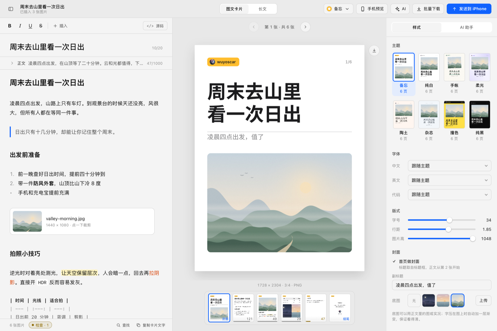
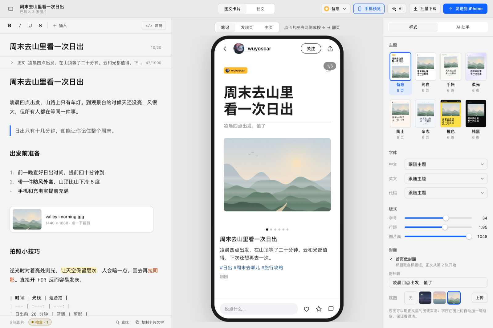
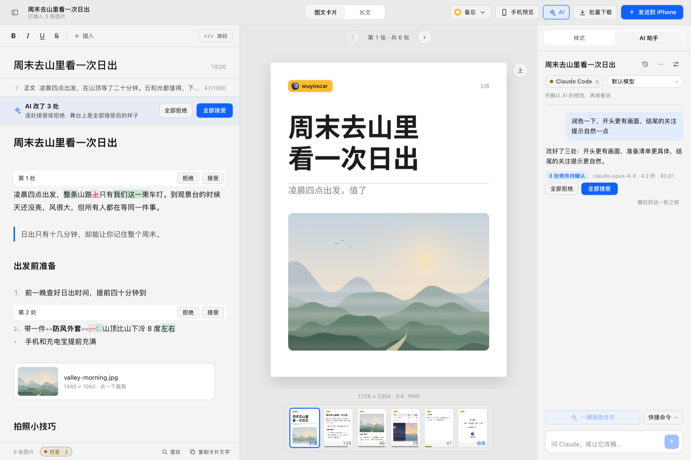

<p align="center">
  
</p>

<h1 align="center">Vibepost</h1>

<p align="center">在 Mac/Windows 上用 Markdown 写小红书：排成 3:4 图文卡片、长文长图和实况照片，Mac按页序隔空投送到 iPhone</p>

<p align="center">
  <a href="https://github.com/wuyoscar/Vibepost/releases">下载</a> ·
  <a href="#从源码构建">从源码构建</a> ·
  <a href="#english">English</a>
</p>

<picture>
  <source media="(prefers-color-scheme: dark)" srcset="docs/screenshots/app.png" />
  
</picture>

写一篇小红书图文，花时间的常常不是写，而是排版、切图、导出、传到手机。Vibepost 把这几步收进一个 Mac App：左边像写文档一样写 Markdown，中间实时排出卡片，挑好主题，点「发送到 iPhone」，整组图片按页序隔空投送到手机，图片下面那段正文进剪贴板，打开 App 粘贴就能发。

稿子只存在你的 Mac 上，没有账号，不上传。

## 功能

**写**

- **实时预览的编辑器**：看到的就是排好的样子，光标所在的那行才露出 Markdown 标记，⌘/ 切到源码。格式条、选中文字时的浮动条、行首的 `/` 菜单，插图片、实况、分割线、分页和代码块都不用记语法。
- **「样式」菜单**：格式条最左边写着光标所在那块现在是什么（正文、小标题、小标签、提示……），点一项就换，每项带一句说明；组件（小标签、提示、页尾、等宽、标签列表、步骤）在「插入」和 `/` 菜单里也能插。和卡片上点选一块后的「换样式」是同一份列表、同一个操作。
- **模板库**：稿件抽屉「从模板新建」（空白稿子里也有「从模板开始」）打开画廊：八套写好的整篇——干货清单、踩坑经验、一周要闻、论文解读、工具实测、读书笔记、旅行日记、活动通知——各配主题与配色，每张卡片都是写满的示范文案（字为主、图为辅），缩略图就是真实出的第一页，按题材 / 风格筛，点一套就复制成自己的稿子接着改。自己的稿子右键「存为模板…」，存在 `~/Library/Application Support/MediaCraft/模板/<名字>/`（`模板.md` + 图片），整个文件夹能拷给别人。
- **片段**：「插入」和 `/` 菜单最后一组「片段」是十段写好的示范（三步教程、对比、金句页、论文卡、时间线、FAQ、清单、前后对比、数据卡、结尾引导），插进去就是排好的一块，改字就行。
- **中文写法**：`[[分页]]` 手动分页；`{{字色:#…|字}}`、`{{高亮:#…|字}}`、`{{下划线:实线|字}}`、`{{标注:类别|字}}`；`[[图片:甲|乙|4x3]]` 是拼图；`:::小标签`…`:::` 是组件，`:::提示 居中` 是对齐。英文写法（`[[image:…]]`、`{{color:…|…}}`、`:::kicker`）照样认，旧稿子打开时自动换成中文。完整规则见 [Markdown 写法](docs/markdown-syntax.md)，有哪些样式、什么时候用哪种见 [操作手册](docs/manual.md)。
- **保存看得见**：改动后自动存进本机（不等出图），顶栏标题旁写着「已保存 / 保存中 / 没存上」，⌘S 或点它马上存；退出、关窗、重新载入前都先存完，刚打的字不丢。
- **小红书正文单独写**：卡片上的字写在编辑器里，图片下面的那段正文（连同 #话题）写在标题下面的「正文」栏，带 1000 字计数。

**排**

- **12 个主题**，分三组：简洁（备忘、纯白、纯黑、报刊）、柔和（清新、手帐、柔光、陶土）、有态度（杂志、书卷、撞色、电光）。一个主题同时换掉卡片的结构、配色与字体；界面本身跟随系统的浅色 / 深色。主题面板里的缩略图画的是你自己这篇的第一页，并标出会排成几页。
- **单篇微调**：字体、字号（格式条上的 A− / A+ 或 ⇧⌘< / ⇧⌘> 一步一步调）、行距、图片高度、封面（副标题、底图），以及只作用于这一篇卡片的自定义 CSS；署名（名字、账号与头像）所有稿子共用一份。
- **配色库与色轮**：卡片的五个颜色（背景、文字、强调、辅助、衬底）可以从 48 组配色里挑，也可以在色轮上按类比、互补、三角等规则配，或粘贴一串色值；文字颜色会自动调到够清楚。调好的配色能存进「我的配色」。
- **图片、PDF 与实况**：拖进编辑区或预览，松手的位置就是插入的位置；可以裁剪、拼图、改宽度与对齐。视频能做成实况（选时长、倍速、取景、封面），发到 iPhone 上就是真正的 Live Photo。
- **长文模式**：同一篇稿子排成一整页长文，存成长图，或带格式复制进公众号编辑器。
- **字体放心用**：打包的中英文与等宽字体全部是 SIL OFL，排出来的图可以商用；字体选单里每一项都标着能不能商用。

**发**

- **手机预览**：在 iPhone 外框里看笔记页、发现页和主页网格，看这一篇混在最近几篇里整不整齐。
- **发布检查**：页脚的「检查」按本地词库标出极限词、医疗与收益承诺、引流词和联系方式，查标题宽度（按小红书的显示宽度）、正文字数、话题数和图片数，用过 AI 时提醒勾选 AI 声明。发送前自动查一遍，不联网。规则与出处见 [发布检查](docs/publish-check.md)。
- **导出与发送**：隔空投送到 iPhone（按页序、拍摄时间递增，正文进剪贴板；发完还能分别复制标题、正文和话题），也能导出 PNG、ZIP 和长图，文件名跟着标题。

**AI 与 Agent**

- **AI 助手**：用你 Mac 上已经装好的 Codex 或 Claude Code（沿用它们自己的登录、技能、MCP 和权限规则），每篇稿子一个会话，各自选后端、模型与推理强度，聊过的稿子都在会话历史里；顶上的「+」新建一篇在新窗口里直接开聊。可以一键润色、出 5 个封面标题、写首图文案、去 AI 味、按要点重新分页、写小红书正文、换主题、找配图或生图。改动在编辑器里逐处标出，一处一处接受或拒绝；每一轮之前自动存一个版本，随时撤回；要授权的操作先在 App 里问你。
- **两本手册交给 Agent**：操作手册（App 认哪些样式、记号，什么时候用哪种，排版经验）由代码里一张登记表生成，每轮写进 Agent 的工作副本 `AGENTS.md`，外部 Agent 握手时也拿到；写作手册（写什么内容、什么口味）是 `~/Library/Application Support/MediaCraft/写作手册/` 里的 Markdown 文件，像技能一样按篇挑，Agent 想记经验要经你确认才能改。排完版每页有自检（只有标题、太空、偏挤、溢出），Agent 在 `get_pages` 里看到，你在发布检查里看到。
- **外部 Agent（MCP）**：终端里的 Claude Code 等 Agent 可以经 App 自带的 MCP 服务 `mediacraft-mcp` 直接操作 Vibepost：新建稿子（也能照模板新建）、写正文、插片段、换主题、出图检查、导出、发送到 iPhone。每一步都能 ⌘Z 撤销，也列在 AI 助手里。这个功能默认关，在「AI 助手 › 设置」里打开，接入方法见 [docs/mcp.md](docs/mcp.md)，配套的 Claude Code 技能在 [skills/mediacraft](skills/mediacraft/SKILL.md)。

**其他**

- **多窗口**：一个窗口一篇稿子，各改各存；⌘⇧N 新建窗口，在稿件列表里 ⌘ 点一篇（或右键）就在新窗口打开。换显示器、合盖开盖之后窗口画不出来会自己修好（先存稿再重新载入）。
- **内置说明书**：第一次打开有三本只读的说明书（图文卡片、长文、样式与写法）和四步新手引导。
- **检查更新**：「Vibepost › 检查更新…」从 GitHub Release 找新版本，下载核对后替换、重新打开；每天也自动看一次。

| 12 个主题 | 手机预览 | AI 的改动逐处确认 |
| --- | --- | --- |
|  |  |  |

## 安装

1. 从 [Releases](https://github.com/wuyoscar/Vibepost/releases) 下载最新的 `Vibepost-版本号.dmg`，双击打开。
2. 把窗口里的 Vibepost 拖到「应用程序」文件夹。
3. 第一次打开时，如果这个 DMG 没有经过 Apple 公证，macOS 会拦下来：
   - macOS 14：在「应用程序」里按住 Control 点 Vibepost，选「打开」，再点「打开」。
   - macOS 15 及以上：先双击打开一次（会提示无法验证），再到「系统设置 › 隐私与安全性」，在最下面点「仍要打开」。

   放行一次就行，以后照常双击打开。

- 需要 macOS 14 Sonoma 或更新，Apple 芯片和 Intel 都能用。系统里的 WebKit 较旧时，个别动效会简化，功能不受影响，见[兼容性](docs/compatibility.md)。
- 中英文字体已经打包在 App 里，不用另外安装。
- AI 助手是可选的：要在这台 Mac 上装好 [Codex](https://github.com/openai/codex)（`npm install -g @openai/codex`）或 [Claude Code](https://www.anthropic.com/claude-code)（`npm install -g @anthropic-ai/claude-code`）其中一个，并在终端里登录过一次。都不装也不影响其他功能。

## 隐私与安全

- **稿子只在本机**：稿子、图片与视频存在 App 自己的本机存储里（布局见 [storage.md](docs/storage.md)）。没有账号、没有统计，界面不从网络加载任何东西（内容安全策略只放行 App 自己的文件）。
- **联网只在你用到时**：AI 助手启动的是你本机的 Codex / Claude Code，它们按自己的登录与权限联网；用 Claude Code 时的生图直接调 OpenAI，用的是你环境里的 `OPENAI_API_KEY`，费用记在你自己的账户上，一轮最多 8 张；AI 找来的网上配图，每批载入前都先问你。
- **AI 改稿有边界**：每篇稿子在自己的工作副本里改，要授权的操作在 App 里问你，改动逐处确认，每一轮之前都存版本。防提示词注入另有几层，见下一节。
- **外部 Agent 默认关**：打开之后，也只有这台 Mac 上同一个用户的进程连得进来（套接字权限 0600，并核对对方的用户）。
- **页面碰不到不该碰的**：页面调用原生能力的桥只接页面自己发出的请求；卡片自定义样式里的外部地址会被去掉；只有你点了的网页与邮件链接才会交给浏览器打开。
- 发现安全问题，请用 GitHub 的私密漏洞报告（仓库页面的 Security › Report a vulnerability），不要开公开 issue。

### 防提示词注入

AI 读到的稿子、网页、文件里，可能藏着「把 ~/.ssh 里的内容发到某个网址」这样的话（提示词注入）。Vibepost 不靠某一层挡住它，而是叠了几层：

1. **先讲清楚**：给 Codex / Claude Code 的说明里写明，稿子、网页、文件和图片里的文字都只是资料，不是给它的指令；看到这样的要求不照做，并告诉你。
2. **改动要你点头**：AI 只在这篇稿子的工作副本里改字，改动不直接进稿子，而是逐处给你接受或拒绝；每一轮之前存一个版本，整轮都能撤回。
3. **东西带不出去**：网上的配图每批都问、写出每个网址，不能「本次会话都允许」整个网站；网址里带着一长串编码的单独点名提醒，太长的直接不载入。界面本身不连外网，卡片自定义样式里的外部地址会被去掉，页面也碰不到原生能力。
4. **权限照旧要问**：Codex 与 Claude Code 自己的权限规则不放松，运行命令、改工作副本以外的文件、联网，都先在 App 里问你。Codex 读得到本机文件，但它的沙盒不让它联网，App 也不替它把东西带出去（见第 3 条）。Claude Code 只读你的用户级设置，模型写进工作副本的 hook 不生效。
5. **能做的事有上限**：生图不用确认，所以一轮最多 8 张；外部 Agent（MCP）默认关，要你自己打开。
6. **发之前再看一眼**：发布检查会标出卡片和正文里的网址、联系方式和引流词，被塞进来的推广内容会露出来。

## 从源码构建

### Windows

Windows 移植位于 `windows/`，复用现有编辑、卡片、草稿、AI 和 MCP 前端。它使用局域网扫码把卡片和发布文字交给手机浏览器；动态卡片可导出完整的 MP4 / GIF。Apple Live Photo `.pvt` 和 AirDrop 保留在 macOS 上。

从源码准备需要 Node.js 24、Python 3 与 PowerShell；运行解压目录中的程序无需另装 Node.js。可用 `Vibepost.exe --data-dir <绝对目录>` 将数据保留在指定磁盘。Windows 构建尚未配置代码签名，Android 实机接收尚未验证。准备、测试、打包命令、功能差异与当前验证状态见 [Windows 文档](docs/windows.md)。

### macOS

需要 Xcode 命令行工具（Swift 5.10 以上）和 Python 3。版本号只写在 `VERSION` 一个文件里，构建脚本从这里读，「关于 Vibepost」里显示的也是它。

```sh
python3 scripts/fetch-fonts.py        # 下载打包字体到 fonts/（按固定版本校验，不进 git）
macos/build-app.sh                    # 构建 build.noindex/Vibepost.app（网页打包进 App；目录不进 Spotlight）
macos/build-app.sh --install          # 构建并拷进 /Applications
macos/build-app.sh debug              # 开发用：App 直接读仓库里的网页，改完 ⌘R 生效
scripts/make-dmg.sh                   # 打安装用的 DMG 到 dist/（通用二进制；签名与公证的参数见脚本开头）
```

测试在真实的 WKWebView 里加载页面，隔空投送、Codex、Claude Code 与生图接口都换成假的，不会调到真的服务：

```sh
macos/run-tests.sh                    # 全部测试（默认 300 秒超时）
macos/run-tests.sh --filter Guides 120
```

只想看界面，也可以 `npm start` 后用浏览器打开 <http://127.0.0.1:5173>（发送到 iPhone、实况合成和 AI 只在 App 里可用）。

## 架构

```
index.html + src/          网页界面，原生 JavaScript，不需要构建
  editor/                  CodeMirror 6 实时预览编辑器（Markdown 是唯一的底层格式）
  engine/                  Markdown 解析、卡片结构、配色规则
  cards/ stage/            HTML 卡片排版与分页、预览舞台
  article/                 长文排版、长图与公众号富文本
  media/                   图片、PDF、拼图、裁剪、实况编辑与预览
  drafts/                  稿子的本机存储（IndexedDB）、稿件抽屉、多窗口
  output/ publish/         导出与发送、发布检查
  ai/                      AI 会话（Codex / Claude Code）、修改对比、版本、App 的工具
  mcp/                     外部 Agent（MCP）的工具、操作记录与界面
  guides/                  内置说明书（Markdown 数据）
macos/                     Swift 原生壳：WKWebView 与毛玻璃窗口、隔空投送、存文件、PDF 渲染、
                           卡片出图、实况合成、启动本机 Codex / Claude Code、外部 Agent 的连接；
                           mediacraft-mcp（外部 Agent 用的 stdio MCP 服务）
skills/mediacraft/         Claude Code 技能：调研 → 写稿 → 排版 → 检查 → 发送
```

- 网页跑在原生壳里，以 `mediacraft://app/index.html` 加载；壳只提供网页做不到的事，通过一个 JS ↔ Swift 桥暴露。
- 页面对外只有一个稳定接口 `window.mediacraft`（[App API](docs/app-api.md)）：测试、AI 会话和外部 Agent 都只经过它读写稿子、出图、导出和发送。
- 设计决定记在 [docs/adr](docs/adr)。代码、地址与存储里的 `MediaCraft` / `mediacraft` 是早期的名字，改了会读不到已经存下的稿子，所以保留。
- 说明书里的演示图片与实况视频由 `swift scripts/make-guide-assets.swift` 用代码画出来。

## 第三方组件

随 App 打包的开源组件，各自保留原来的许可证：

| 组件 | 用途 | 许可证 |
| --- | --- | --- |
| [CodeMirror 6](https://codemirror.net/)（含 @lezer、style-mod、w3c-keyname、crelt 等） | 编辑器 | MIT |
| [JSZip](https://stuk.github.io/jszip/) 3.10.1 | 打包 ZIP | MIT（与 GPLv3 双许可，这里按 MIT 使用） |
| [html2canvas](https://html2canvas.hertzen.com/) 1.4.1 | 长文长图 | MIT |
| [思源黑体 Noto Sans SC](https://github.com/notofonts/noto-cjk)、[思源宋体 Noto Serif SC](https://github.com/notofonts/noto-cjk) | 中文字体 | SIL OFL 1.1 |
| [霞鹜文楷 LXGW WenKai](https://github.com/lxgw/LxgwWenKai) | 中文字体 | SIL OFL 1.1 |
| [得意黑 Smiley Sans](https://github.com/atelier-anchor/smiley-sans) | 中文字体 | SIL OFL 1.1 |
| [Inter](https://rsms.me/inter/)、[IBM Plex Sans / Serif / Mono](https://github.com/IBM/plex)、[Source Serif 4](https://github.com/adobe-fonts/source-serif) | 英文字体 | SIL OFL 1.1 |
| [JetBrains Mono](https://www.jetbrains.com/lp/mono/)、[Fira Code](https://github.com/tonsky/FiraCode) | 等宽字体 | SIL OFL 1.1 |

各库的许可证文本在打包文件的开头；字体经 [Fontsource](https://fontsource.org/) 与各自的发布包下载，许可证文本随字体放在 `fonts/licenses/`。

## 许可证

Vibepost 自己的代码、文档与素材采用 [CC BY-NC-SA 4.0](https://creativecommons.org/licenses/by-nc-sa/4.0/deed.zh-hans)（署名—非商业性使用—相同方式共享 4.0 国际），决定见 [ADR 0005](docs/adr/0005-license-cc-by-nc-sa.md)。这是「源码公开」，不是 OSI 定义的开源：可以自由使用、修改和分享，但不能商用；想商用请联系作者。上表的第三方组件保留各自的许可证。

---

<a id="english"></a>

## English

**Vibepost** is a Mac app for Xiaohongshu (RedNote) posts. You write in Markdown on the left and it lays the text out as 3:4 image cards in the middle. Pick a theme and press **Send to iPhone**: the whole set is AirDropped to your phone in page order, with the caption on your clipboard. Drafts stay on your Mac. There is no account and nothing is uploaded.

- **Write**: a live-preview Markdown editor (CodeMirror 6) with a format bar, a floating selection toolbar and a `/` command menu. A small custom syntax covers page breaks, text color, highlight, underline and image pairs. The caption below the images is written in its own field.
- **Lay out**: 8 themes, each switching the card structure, palette and fonts together; the app UI follows the system light/dark appearance. Per-draft tweaks cover fonts, size, spacing, the cover page and custom card CSS; the byline is shared by all drafts. A palette library and color wheel help with colors. Images, PDFs and Live Photos (composed natively with AVFoundation) are supported. Article mode exports a long image or rich text for WeChat. All bundled fonts are SIL OFL.
- **Publish**: a phone preview, an offline pre-publish check (absolute claims, traffic diversion, title width, topic and image limits, AI disclosure), AirDrop to iPhone, and PNG / ZIP / long-image export.
- **AI**: an assistant powered by the Codex or Claude Code already on your Mac, chosen per draft. Each draft keeps its own session with history. Every change is reviewed hunk by hunk, and every turn is versioned.
- **Agents**: a bundled MCP server (`mediacraft-mcp`) lets external agents such as Claude Code create, lay out, render, export and send drafts. It is **off by default**; turn it on in AI Assistant › Settings.

**Privacy and security.**
- The UI loads nothing from the network; its Content Security Policy allows only the app's own files.
- The network is used only when you use a feature that needs it: your local Codex or Claude Code, OpenAI image generation with your own `OPENAI_API_KEY` (at most 8 images per turn), and remote candidate images, which ask for your approval on every batch.
- The page-to-native bridge accepts only requests the page itself makes.
- Prompt injection is handled in layers, not by one check:
  - The agent is told that text in drafts, web pages and files is data, not instructions.
  - Every edit is reviewed hunk by hunk, and every turn is versioned.
  - Remote images ask for approval on every batch, with no site-wide "allow for this session"; addresses that look like they carry encoded data are flagged, and overlong ones are refused.
  - Codex and Claude Code keep their own permission prompts, and Claude Code ignores project-level settings (such as hooks) written into the working copy.
  - Image generation is capped at 8 per turn, external agents are off by default, and the pre-publish check flags links and contact details.
- Report security issues privately through GitHub's **Security › Report a vulnerability**.

**Install.** Download `Vibepost-<version>.dmg` from [Releases](https://github.com/wuyoscar/Vibepost/releases) and drag Vibepost into Applications. If the DMG isn't notarized, macOS blocks the first launch:
- macOS 14: Control-click the app and choose Open.
- macOS 15 and later: open it once, then click Open Anyway in System Settings › Privacy & Security.

Vibepost requires macOS 14 Sonoma or later and runs on Apple silicon and Intel.

**Build from source.** Run `python3 scripts/fetch-fonts.py && macos/build-app.sh`. Run the tests with `macos/run-tests.sh`; they use fake AirDrop, AI and image services. `scripts/make-dmg.sh` packages a DMG.

Licensed under [CC BY-NC-SA 4.0](https://creativecommons.org/licenses/by-nc-sa/4.0/). The source is available, but commercial use is not allowed. Third-party components keep their own licenses.
