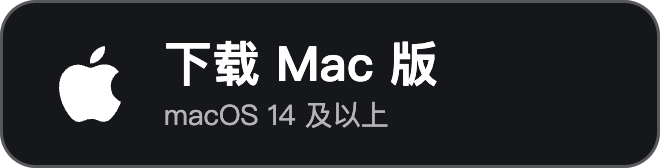
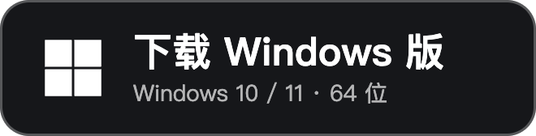
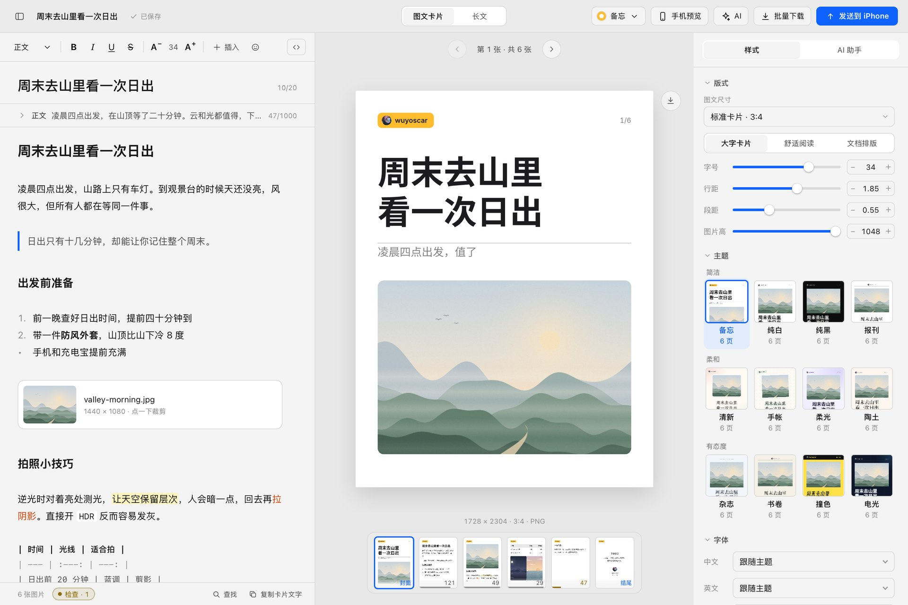
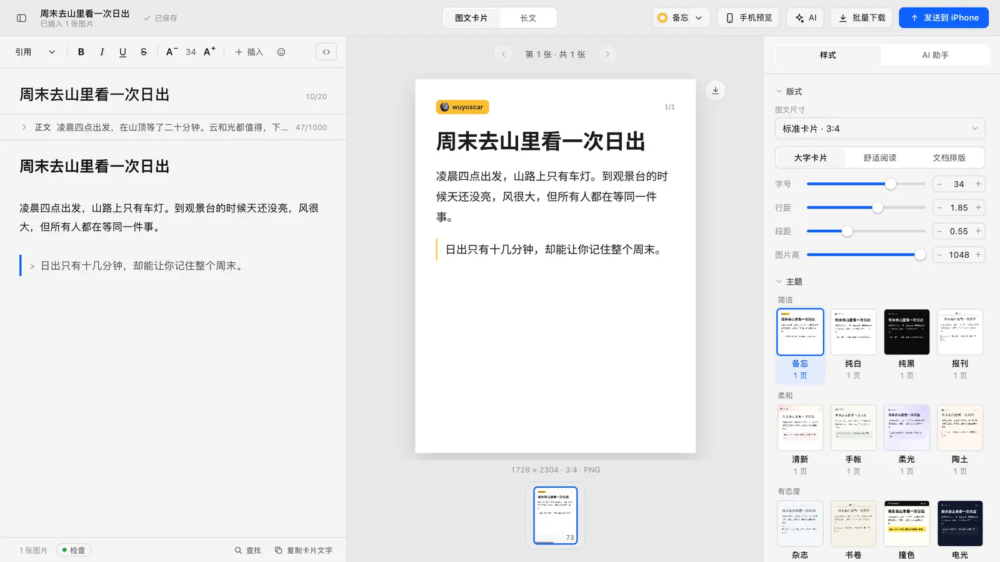
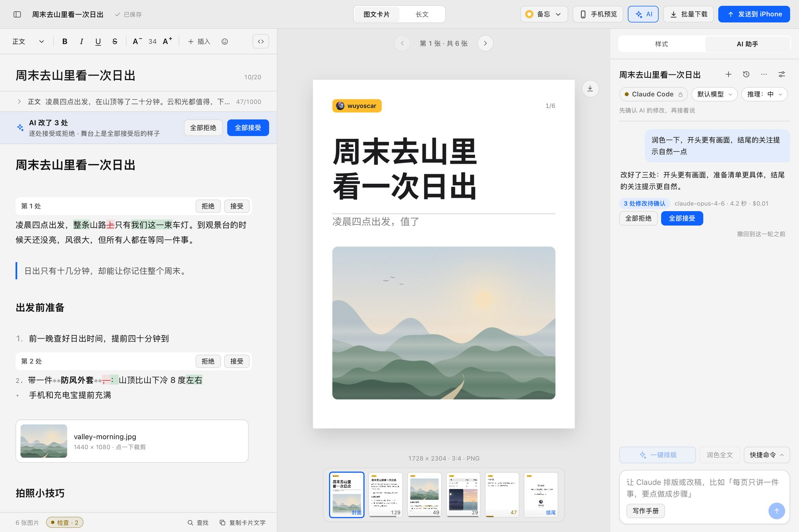
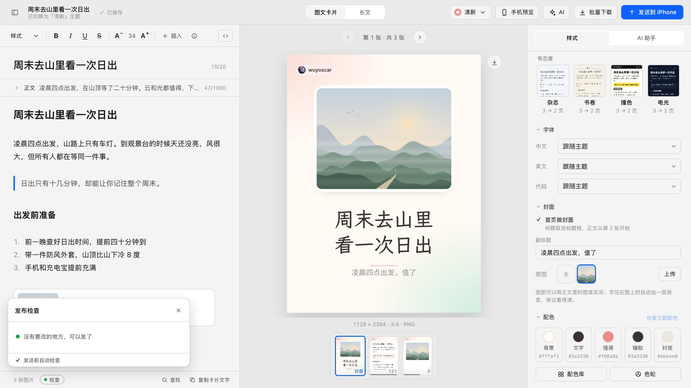
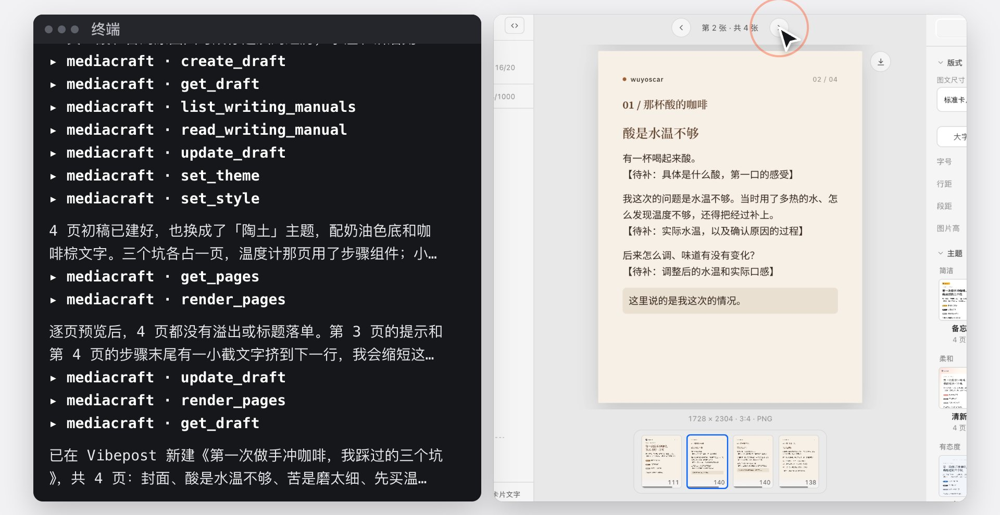

<p align="center">
  
</p>

<h1 align="center">Vibepost</h1>

<p align="center">把 Markdown 排成小红书图文卡片的桌面 App。你写字，Agent 排版、配图，每处改动你点头才算数。</p>

<p align="center">
  <a href="https://github.com/wuyoscar/Vibepost/releases/latest/download/Vibepost-macOS.dmg"></a>
  &nbsp;
  <a href="https://github.com/wuyoscar/Vibepost/releases/latest/download/Vibepost-Windows-Setup.exe"></a>
</p>

<p align="center">免费。稿子只存在你的电脑上，不用注册账号。</p>

https://github.com/user-attachments/assets/1174a624-08ca-4708-a3d3-f52d80c84230

## 安装

**Mac**

1. 点上面的「下载 Mac 版」，打开下载好的 `.dmg`，把 Vibepost 拖进「应用程序」。
2. 第一次打开，系统会拦一下（App 还没做 Apple 公证），放行一次就行：
   - macOS 15 及以上：先双击打开一次，再到「系统设置 › 隐私与安全性」，拉到最下面点「仍要打开」。
   - macOS 14：在「应用程序」里按住 Control 点 Vibepost，选「打开」。

以后有新版本，点菜单「Vibepost › 检查更新…」。

**Windows**

1. 点上面的「下载 Windows 版」，运行下载好的安装程序。
2. 弹出「Windows 已保护你的电脑」时，点「更多信息」，再点「仍要运行」（安装包还没有代码签名）。

Windows 版发到手机用的是扫码，带视频的卡片导出成 MP4 / GIF；没有隔空投送和实况照片。

**想用 AI 排版（可选）**

AI 助手用的是你电脑上的 Claude Code 或 Codex。装一个，在终端里登录一次：

```sh
npm install -g @anthropic-ai/claude-code   # 装好后运行一次 claude
npm install -g @openai/codex               # 装好后运行一次 codex login
```

不装也能写、排、检查、发送。

## 五步发一篇



左边写，中间看卡片，右边调样式。

### 1. 写

像写文档一样打字。`#` 是标题，`1.` 是列表，行首按 `/` 插图片、分页和组件。不想从空白开始，可以从 13 套模板里挑一套改。



### 2. 排

点一个主题，卡片的结构、配色、字体一起换。一共 12 个。


### 3. 让 Agent 帮忙（可选）

点「AI 助手」，说一句要什么，或者直接点「一键排版」。它改的每一处都标在正文里，你逐处接受或拒绝。



它生成的配图先放在对话里，你点了哪张，哪张才进稿子。


### 4. 发之前看一眼

「检查」会标出极限词、引流词和联系方式，顺便查标题长度、字数和话题数。「手机预览」是它在手机上的样子。

| 发布检查 | 手机预览 |
| --- | --- |
|  |  |

### 5. 发到手机

点「发送到 iPhone」，隔空投送里选自己的手机。图片按顺序进相册，正文已经在剪贴板里，打开小红书粘贴就能发。


每一步的细节在[使用手册](docs/guide.md)。

## 还能做什么

- **长文**：同一篇稿子排成一整页，存成长图，或带格式贴进公众号。
- **实况照片**：视频做成 Live Photo，发到 iPhone 上会动（Mac 版）。
- **图片和 PDF**：拖进来就插在松手的位置，能裁剪、拼图。
- **多窗口**：一个窗口一篇稿子，⌘⇧N 再开一个。


## 自己调

右边「样式」里都能调，改的是当前这一篇：

- 配色：5 个颜色自己改，或从 48 组配色里挑
- 尺寸：3:4、A4、9:16、1:2
- 字号、行距、段距、图片高度
- 中文、英文、代码各选字体，打包的字体都能商用
- 封面、署名和头像（署名所有稿子共用，改一次就行）


写作手册、模板、给一篇单独写卡片 CSS，见[自己定制](docs/customize.md)。

## 接上你自己的 Agent

除了 App 里的 AI 助手，终端里的 Claude Code、Codex，还有 Claude Desktop、Cursor 或你自己写的程序，都能经 MCP 连进来：新建稿子、写内容、排版、出图、导出。



先在 App 里打开「AI 助手 › 设置 › 允许外部 Agent 连接」，再登记一次：

```sh
claude mcp add mediacraft -- "/Applications/Vibepost.app/Contents/MacOS/mediacraft-mcp"
codex mcp add mediacraft -- "/Applications/Vibepost.app/Contents/MacOS/mediacraft-mcp"
```

别的客户端、Windows 上的写法和工具清单见 [外部 Agent（MCP）](docs/mcp.md)。App 里的 AI 助手能做什么、怎么管它，见 [AI 助手](docs/ai-assistant.md)。

## 隐私

- 稿子、图片、视频都只存在你的电脑上。没有账号，没有统计。
- App 自己不联网。联网的只有你用到的 AI：它是你本机的 Claude Code 或 Codex，用的是你自己的登录。
- AI 改稿子要你逐处确认；它想运行命令、联网、改别的文件，都先问你。
- 外部 Agent 的连接默认是关的。

细节和防提示词注入的做法见[隐私与安全](docs/security.md)。

## 文档

| | |
| --- | --- |
| [使用手册](docs/guide.md) | 从写到发的每一步 |
| [Markdown 写法](docs/markdown-syntax.md) | 编辑器认的全部写法 |
| [操作手册](docs/manual.md) | 有哪些样式和组件，什么时候用哪种 |
| [自己定制](docs/customize.md) | 配色、版式、字体、封面、署名、写作手册、模板、卡片 CSS |
| [AI 助手](docs/ai-assistant.md) | App 里的 AI 能做什么、怎么管它 |
| [外部 Agent（MCP）](docs/mcp.md) | 各种 Agent 怎么接、工具清单、例子 |
| [发布检查](docs/publish-check.md) | 查什么、词库出处、字体许可 |
| [隐私与安全](docs/security.md) | 数据在哪、什么时候联网、防提示词注入 |
| [Windows](docs/windows.md) | Windows 版的功能范围与构建 |
| [参与开发](CONTRIBUTING.md) | 从源码构建、测试、架构、约定 |

更多（App API、存储、兼容性、发版、设计决定）在 [docs/](docs)。

## 许可证

[CC BY-NC-SA 4.0](LICENSE)：可以自由使用、修改和分享，要署名，不能商用，改过的版本用同样的许可证。想商用请联系作者。

<details>
<summary>第三方组件</summary>

随 App 打包的开源组件，各自保留原来的许可证：

| 组件 | 用途 | 许可证 |
| --- | --- | --- |
| [CodeMirror 6](https://codemirror.net/)（含 @lezer、style-mod、w3c-keyname、crelt 等） | 编辑器 | MIT |
| [JSZip](https://stuk.github.io/jszip/) 3.10.1 | 打包 ZIP | MIT（与 GPLv3 双许可，这里按 MIT 使用） |
| [html2canvas](https://html2canvas.hertzen.com/) 1.4.1 | 长文长图 | MIT |
| [思源黑体 Noto Sans SC](https://github.com/notofonts/noto-cjk)、[思源宋体 Noto Serif SC](https://github.com/notofonts/noto-cjk) | 中文字体 | SIL OFL 1.1 |
| [霞鹜文楷 LXGW WenKai](https://github.com/lxgw/LxgwWenKai) | 中文字体 | SIL OFL 1.1 |
| [得意黑 Smiley Sans](https://github.com/atelier-anchor/smiley-sans) | 中文字体 | SIL OFL 1.1 |
| [Inter](https://rsms.me/inter/)、[IBM Plex Sans / Serif / Mono](https://github.com/IBM/plex)、[Source Serif 4](https://github.com/adobe-fonts/source-serif) | 英文字体 | SIL OFL 1.1 |
| [JetBrains Mono](https://www.jetbrains.com/lp/mono/)、[Fira Code](https://github.com/tonsky/FiraCode) | 等宽字体 | SIL OFL 1.1 |

各库的许可证文本在打包文件的开头。字体经 [Fontsource](https://fontsource.org/) 与各自的发布包下载，许可证文本随字体放在 `fonts/licenses/`。Windows 版另外打包的组件（Electron、PDF.js、FFmpeg 等）见 [docs/windows.md](docs/windows.md#固定依赖与许可证)。

</details>
