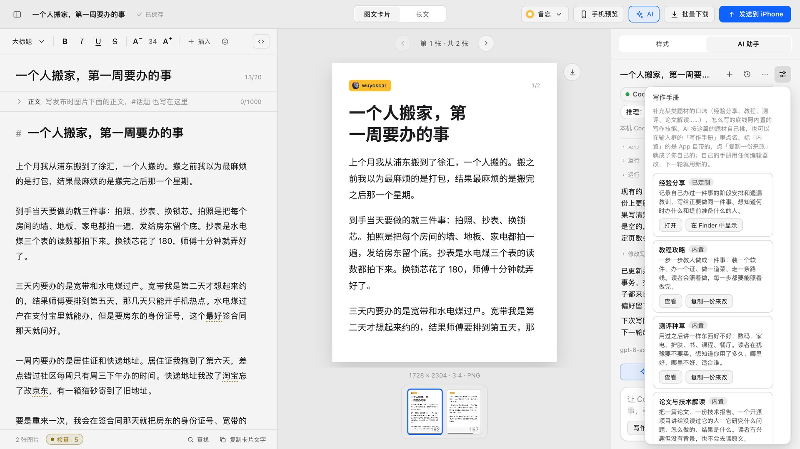

# 自己定制

样式都在右边检查器的「样式」里，各节能收起，滑杆旁的数值框可以直接输入。除了署名，改的都是当前这一篇。

### 主题与配色

「主题」一节点一个主题，卡片结构、配色、字体一起换，这篇调过的配色重置；新稿子沿用上次选的主题。「配色」一节是卡片的五个颜色：背景、文字、强调、辅助、衬底。可以一个个改色块，从「配色库」的 48 组里挑，或在「色轮」上按类比、互补、三角等规则配，也可以粘贴一串色值。文字颜色会自动调到够清楚。调好的配色能存进「我的配色」，别的稿子也能用。界面本身跟随系统的浅色 / 深色，不跟着卡片主题变。规则见 [App API 的配色一节](app-api.md#palettes配色库与色轮)。

### 版式：尺寸、字号、行距

「版式」一节：

- **图文尺寸**：标准卡片 3:4（默认）、文档页 A4 比例、竖屏 9:16、长页 1:2。宽度固定，改的是每页的高度。
- **排版密度**：大字卡片、舒适阅读、文档排版三档，只调字号与行距，不动正文和分页。
- **字号、行距、段距、图片高**：四根滑杆。字号也可以用格式条上的 A− / A+ 或 ⇧⌘< / ⇧⌘>。段距是块与块之间的距离，块之间太空就调小。

见 [App API 的「图文尺寸与排版密度」](app-api.md#图文尺寸与排版密度)。

### 字体

「字体」一节分中文、英文、代码三个选单，默认「跟随主题」。打包的字体全部是 SIL OFL，排出来的图可以商用；选单里每一项都标着能不能商用。

### 封面

「封面」一节勾上「首页做封面」：第 1 张是封面，标题取自标题框，正文从第 2 张开始。可以填副标题、选一张底图（正文里的图、实况，或另外上传一张只给封面用）。

### 署名与头像

「样式」最下面的「署名」一节：

- **头像**：点头像换一张图，右边的裁剪按钮选取其中一块。没换过时是 App 的图标。
- **名字**和**账号**：账号可以不填。

署名所有稿子共用一份，改一次，每篇的卡片都跟着变。它出现在这几处：

- 第一张卡片的页眉：头像和名字（开了封面时挪到封面上）。
- 之后每张的页脚：一行署名。
- 结尾页（正文里写 `[[结尾]]`）：最后是大头像、名字和账号。
- 「手机预览」的主页。

名字空着时卡片上只有头像，发布检查会提醒一句，不拦发送。Agent 也能读写署名（`mediacraft.profile`，见 [App API](app-api.md#profile署名)）。

### 写作手册

写作手册补充某类题材的口味，AI 按这篇的题材自己挑，也可以在输入框旁的「写作手册」里点名。App 内置四份：经验分享、教程攻略、测评种草、论文与技术解读。

- 想改内置的：AI 设置 › 写作手册里点「复制一份来改」。同名的用你那份，删掉文件就回到内置的。
- 想从一篇稿子里提炼：点快捷命令「存成我的写作手册」，AI 把这篇的写法写成一份新手册，保存前给你确认。
- 想自己写：往 `~/Library/Application Support/MediaCraft/写作手册/` 里放 Markdown 文件，每份开头写 `name` 和 `description`。



你自己的手册 App 从不删。格式见[存储](storage.md#写作手册写作手册)，来由见[写作技能](writing-skills.md#写作手册)。

### 模板

自己的稿子在稿件列表里右键「存为模板…」，之后在「从模板新建」的画廊里和自带的十三套列在一起。模板存在 `~/Library/Application Support/MediaCraft/模板/<名字>/`（`模板.md` 加图片），整个文件夹能拷给别人。格式见[存储](storage.md#模板模板)。

### 卡片样式（CSS）

「样式」里的「高级 · 卡片样式」是这一篇自己的 CSS，只作用在卡片上，不影响 App 界面。每页是 `.mc-page`，正文区 `.mc-body`，组件如 `.mc-note`，配色变量如 `--mc-accent`。例如：

```css
.mc-note { border-radius: 20px; }
```

认不出的组件名（`:::名字`）会排成 `class="mc-c c-名字"` 的容器，所以可以自己起一个组件名再写它的样式。也可以让 AI 助手照你的描述写（它用 `set_card_css`）。外部地址和 `@import` 会被去掉。见 [App API 的 drafts 一节](app-api.md#drafts稿子)与 [Markdown 写法的「组件」](markdown-syntax.md)。
