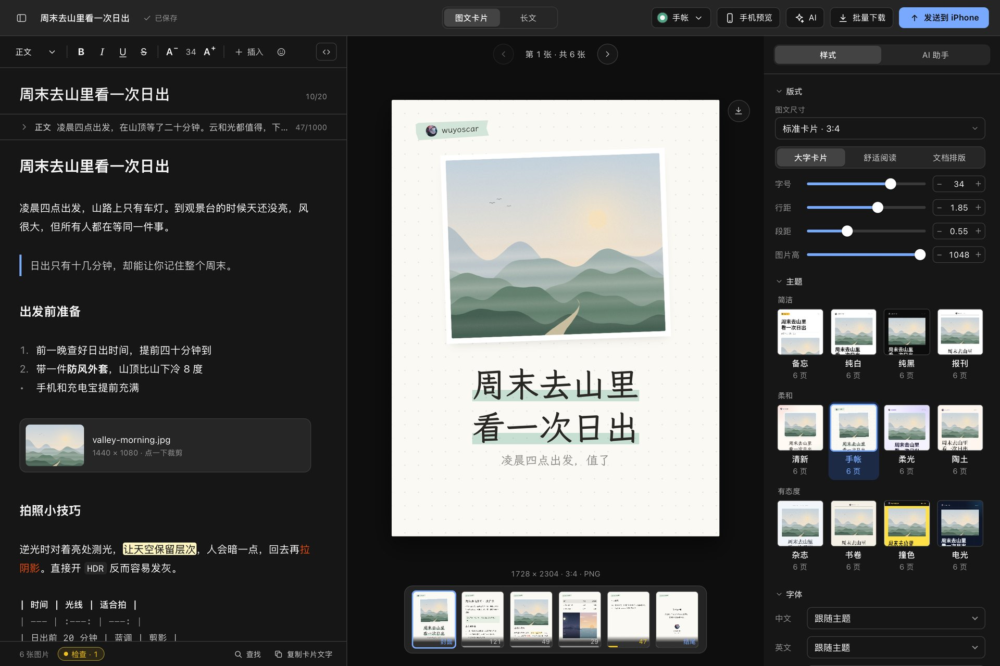
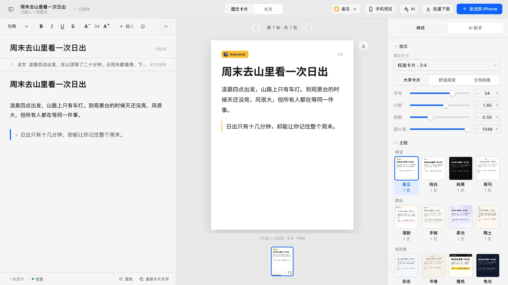
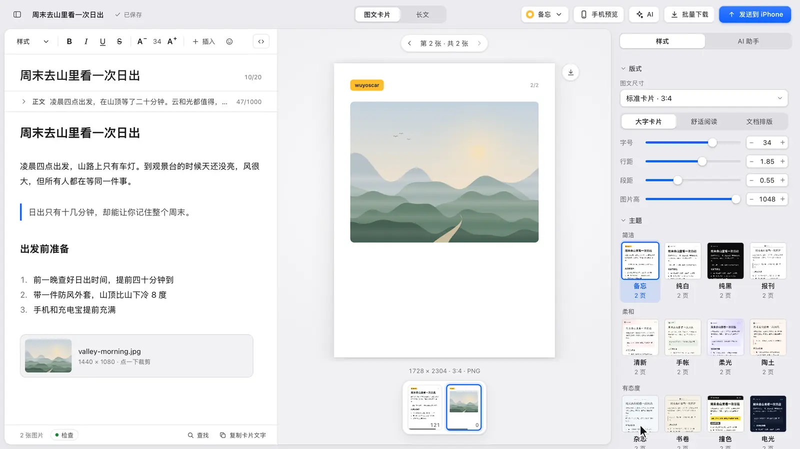
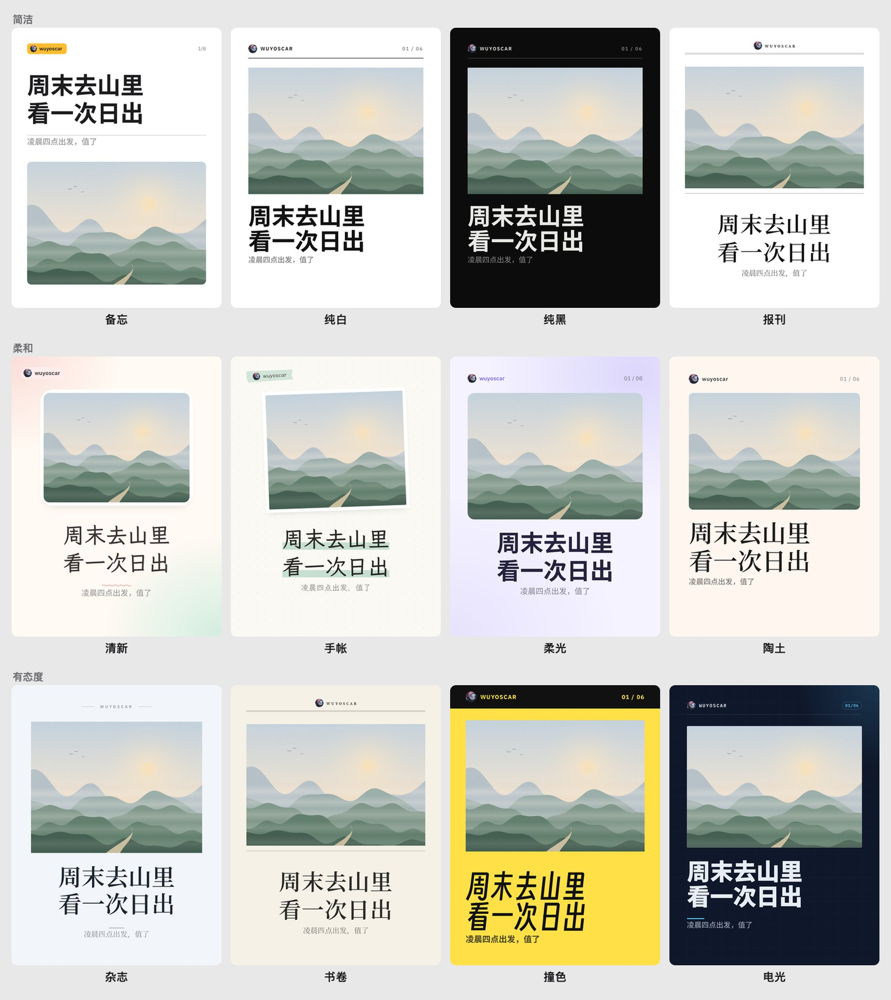
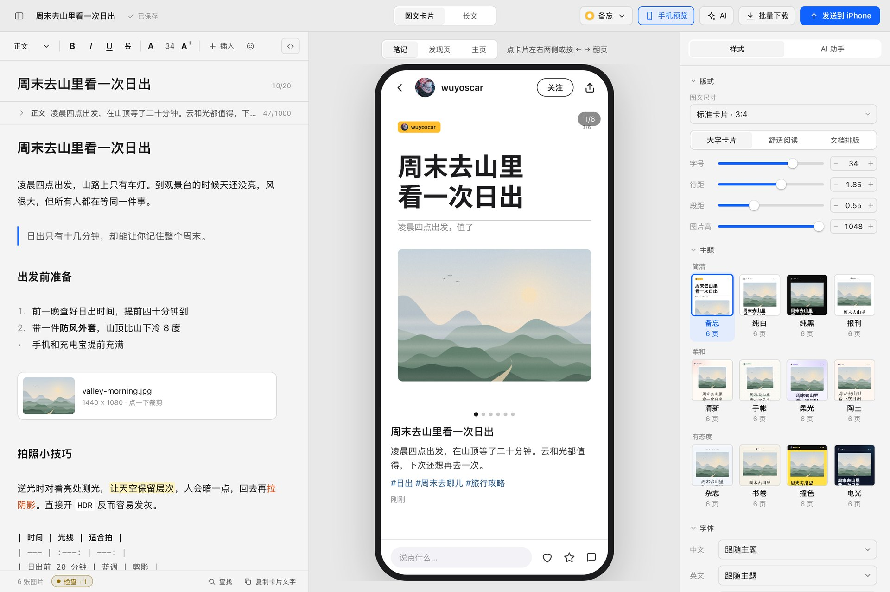
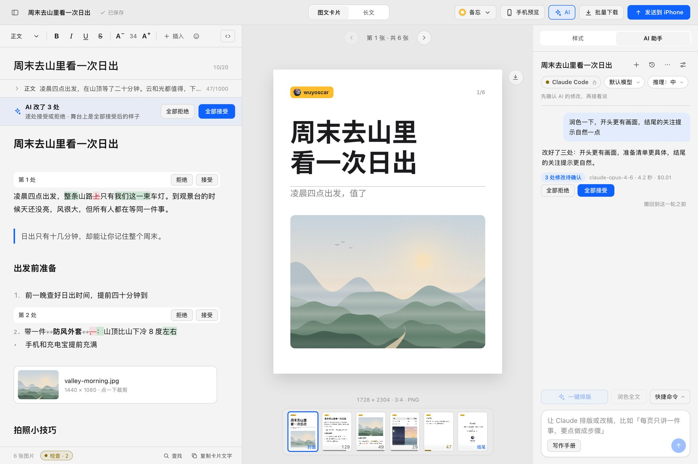

# 使用手册

从写到发的每一步，功能比 README 里列得全。

一篇笔记有三部分：标题、卡片内容（编辑器里的 Markdown，排在图片上的字）、小红书正文（发布时图片下面的那段，连同 #话题）。从写到发是五步。

  

### 1. 写

点稿件栏的 + 开一篇空白稿子，或点「从模板新建」挑一套写好的改。在左边打字，`#` 是标题，`1.` 是列表，行首输入 `/` 插图片、分页和组件。

- **实时预览的编辑器**：看到的就是排好的样子，光标所在的那行才露出 Markdown 标记，⌘/ 切到源码。格式条、选中文字时的浮动条、行首的 `/` 菜单都能用，插图片、实况、分割线、分页和代码块不用记语法。
- **「样式」菜单**：格式条最左边写着光标所在那块现在是什么（正文、小标题、小标签、提示……），点一项就换。和卡片上点选一块后的「换样式」是同一份列表。
- **中文写法**：`[[分页]]` 手动分页，`{{字色:#…|字}}`、`{{高亮:#…|字}}` 给字上色，`[[图片:甲|乙|4x3]]` 是拼图，`:::小标签`…`:::` 是组件。英文写法照样认，旧稿子打开时自动换成中文。完整规则见 [Markdown 写法](markdown-syntax.md)，有哪些样式、什么时候用哪种见[操作手册](manual.md)。
- **模板与片段**：十三套写好的整篇（干货清单、踩坑经验、一周要闻、论文解读、工具实测、读书笔记、旅行日记等），点一套就复制成自己的稿子。「插入」和 `/` 菜单最后一组「片段」是十段写好的示范（三步教程、对比、金句页、时间线、FAQ 等），插进去就是排好的一块。
- **图片、PDF 与实况**：拖进编辑区或预览，松手的位置就是插入的位置。可以裁剪、拼图、改宽度与对齐。视频能做成实况（选时长、倍速、取景、封面），发到 iPhone 上就是 Live Photo。
- **小红书正文单独写**：在标题下面的「正文」栏，带 1000 字计数。
- **保存看得见**：改动后自动存进本机，顶栏标题旁写着「已保存 / 保存中 / 没存上」，⌘S 马上存。退出、关窗、重新载入前都先存完。

### 2. 排

右边「样式」里点一个主题，卡片结构、配色和字体一起换。字号、行距、封面在同一个面板里调，各项见[自己定制](customize.md)。

  

- **12 个主题**，分三组：简洁（备忘、纯白、纯黑、报刊）、柔和（清新、手帐、柔光、陶土）、有态度（杂志、书卷、撞色、电光）。主题面板里的缩略图画的是你自己这篇的第一页，并标出会排成几页。
- **长文模式**：同一篇稿子排成一整页长文，存成长图，或带格式复制进公众号编辑器。
- **表情**：格式条上的笑脸按钮，按分类挑，插到光标所在处。

### 3. 改

想让 AI 帮忙，点右边的「AI 助手」。主按钮「一键排版」看过每一页以后调分页、块的样式和间距，不改你的字。「润色全文」只修错字、读不通和指代不清的地方。也可以直接在对话框里说要做什么。改动标在正文里，逐处接受或拒绝。这一步可以不用，细节见[和 Agent 一起用](ai-assistant.md)。

### 4. 查

- **发布检查**：页脚的「检查」按本地词库标出极限词、医疗与收益承诺、引流词和联系方式，查标题宽度、正文字数、话题数和图片数，用过 AI 时提醒勾选 AI 声明。发送前自动查一遍，不联网。规则与出处见[发布检查](publish-check.md)。
- **手机预览**：顶栏的「手机预览」在 iPhone 外框里看笔记页、发现页和主页网格。

### 5. 发

点「发送到 iPhone」，在隔空投送里选自己的手机。图片按页序到相册，正文在剪贴板里，发完还能分别复制标题、正文和话题。Windows 上是「发送到手机」，手机扫码接收。也能导出 PNG、ZIP 和长图，文件名跟着标题。

### 其他

- **多窗口**：一个窗口一篇稿子，各改各存。⌘⇧N 新建窗口，在稿件列表里 ⌘ 点一篇（或右键）就在新窗口打开。
- **内置说明书**：第一次打开有三本只读的说明书（图文卡片、长文、样式与写法）和四步新手引导。

| 12 个主题 | 手机预览 | AI 的改动逐处确认 |
| --- | --- | --- |
|  |  |  |
